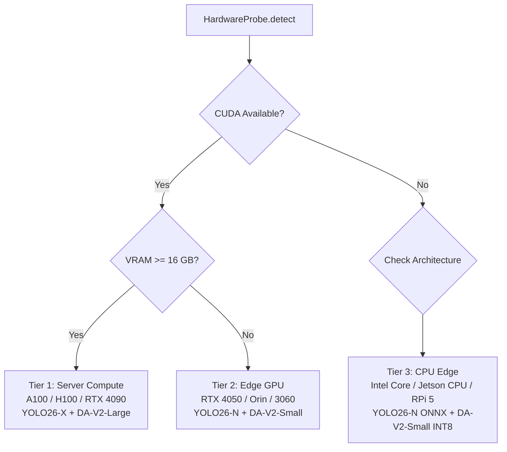

# Blind's Eye: Complete System Dossier & Production Engineering Blueprint

> **Document Version:** 2.0.0-PROD-SPEC  
> **Target Audience:** Systems Architects, Computer Vision Engineers, Edge AI Developers, Assistive Tech Researchers, and Autonomous AI Agents.  
> **Repository Branch:** `withyolov26`  
> **Status:** Full System Architecture Deep Dive, Codebase Audit & Production-Readiness Roadmap.

---

## Table of Contents

1. [Executive Summary & System Mission](#1-executive-summary--system-mission)
2. [High-Level System Topology & Concurrency Architecture](#2-high-level-system-topology--concurrency-architecture)
3. [Hardware Execution Framework & Dynamic Probing](#3-hardware-execution-framework--dynamic-probing)
4. [Perception Stack: Machine Learning Models Deep Dive](#4-perception-stack-machine-learning-models-deep-dive)
   - 4.1 Object Detection: YOLO26 (NMS-Free Real-Time Architecture)
   - 4.2 Monocular Depth Estimation: Depth Anything V2 (DA-V2)
   - 4.3 Spatial Geometry & Centroid Depth Fusion
5. [Speech Synthesis & Audio Pipeline Deep Dive](#5-speech-synthesis--audio-pipeline-deep-dive)
   - 5.1 Dual-Engine Architecture (Piper TTS + Kokoro-82M ONNX)
   - 5.2 Priority Speech Queue & Sub-100ms Mid-Utterance Preemption
   - 5.3 Audio Streaming & Buffer Isolation
6. [Linguistics & Multi-Language Localization Engine](#6-linguistics--multi-language-localization-engine)
   - 6.1 Architecture & Zero-Dependency Design
   - 6.2 COCO-80 Class Translations (English, Hindi, Hinglish)
   - 6.3 Directional & Metric Distance Sentence Formatting
7. [Temporal Smoothing, Debouncing & Spatial Memory](#7-temporal-smoothing-debouncing--spatial-memory)
   - 7.1 Temporal Debouncing & Minimum Duration Thresholds
   - 7.2 Absence Reset & Streak Tracking
   - 7.3 Cognitive Load Throttling & Clustered Announcements
8. [System Deployment, Packaging & Dependency Isolation](#8-system-deployment-packaging--dependency-isolation)
   - 8.1 The ONNX Runtime Package Namespace Hazard
   - 8.2 Production Dockerfile Architecture
   - 8.3 Local Virtual Environment Standards
9. [Codebase Anatomy & Component Reference](#9-codebase-anatomy--component-reference)
10. [Comprehensive Production-Readiness Gap Analysis & AI Discussion Roadmap](#10-comprehensive-production-readiness-gap-analysis--ai-discussion-roadmap)
    - 10.1 Edge Compute & TensorRT Optimization
    - 10.2 Spatial Audio & Binaural HRTF Integration
    - 10.3 Object Tracking & Kinematic Danger Assessment (TTC)
    - 10.4 Metric Depth Grounding & Sensor Fusion (LiDAR/ToF/IMU)
    - 10.5 Embedded Hardware, Thermal & Power Budgeting
    - 10.6 Safety-Critical Telemetry, Watchdogs & Compliance

---

## 1. Executive Summary & System Mission

### 1.1 The Mission
**Blind's Eye** is an edge-native, real-time spatial awareness and safety-critical obstacle navigation system designed for visually impaired and blind individuals. Operating entirely offline without reliance on cloud APIs, the system transforms live monocular video feeds (from wearable smart glasses, chest-mounted cameras, or mobile IP streams) into immediate, context-aware acoustic feedback.

```
┌────────────────────────────────────────────────────────────────────────┐
│                          CORE SYSTEM TENETS                            │
├──────────────────┬──────────────────┬─────────────────┬────────────────┤
│   100% OFFLINE   │  SUB-100ms CRIT  │  ZERO VRAM CLASH│ MULTI-LINGUAL  │
│  Zero cloud API  │ Mid-utterance    │  YOLO (GPU) +   │ English, Hindi │
│  or network dep; │ preemption for   │  DA-V2 (GPU) +  │ & Romanized    │
│  operates remote │ immediate safety │  TTS (CPU-only) │ Hinglish       │
└──────────────────┴──────────────────┴─────────────────┴────────────────┘
```

### 1.2 The Problem Space
Existing assistive technologies suffer from major structural weaknesses:
1. **Network Latency & Privacy Risks:** Cloud-dependent computer vision solutions (e.g., Be My Eyes, GPT-4o vision) fail in subways, basements, or rural areas, and stream sensitive video to external servers.
2. **Audio Clutter & Cognitive Overload:** Naive object detectors flood the user's ears with rapid-fire announcements ("chair, chair, chair, table, person"), causing acoustic fatigue and masking crucial environmental sounds (traffic, footsteps).
3. **Ghost Frames & Buffer Desynchronization:** Decoupled video capture buffers in naive OpenCV implementations queue up stale frames, leading the AI to warn of an obstacle that was present 3 seconds ago, while missing immediate hazards.
4. **Monocular Depth Ambiguity:** Standard 2D bounding boxes provide azimuth (left/right) but cannot tell whether a vehicle is 15 meters away or 1.5 meters away.

### 1.3 The Solution Architecture
Blind's Eye synthesizes **NMS-Free YOLO26 object detection**, **Depth Anything V2 monocular depth estimation**, a **temporal debouncing state machine**, and a **dual-engine offline Text-to-Speech (Piper + Kokoro-82M) priority queue** into a unified, non-blocking pipeline.

---

## 2. High-Level System Topology & Concurrency Architecture

The system operates across **four asynchronously decoupled threads** to isolate components that run at radically different operational frequencies:

```
┌─────────────────────────────────────────────────────────────────────────────────────────┐
│                                 BLIND'S EYE SYSTEM TOPOLOGY                             │
└─────────────────────────────────────────────────────────────────────────────────────────┘

  CAMERA THREAD (Daemon)                  MAIN INFERENCE THREAD
  ┌──────────────────────┐                ┌─────────────────────────────────────────────┐
  │ CameraStream (OpenCV)│                │ src/main.py Orchestrator Loop               │
  │ • Grab 30-60 FPS     │    Latest      │ • Cap inference to --max-fps (e.g. 10 FPS)  │
  │ • Drain buffer       │─── Frame ─────▶│ • Forward pass YOLO26 (main thread)         │
  │ • Zero-lag drop      │    (Lockless)  │ • Extract bounding boxes & centroids (cx,cy)│
  └──────────────────────┘                └──────────────────────┬──────────────────────┘
                                                                 │
                                          Centroid Coordinates   │ Disparity Matrix
                                          (cx, cy)               │ (Async Fused)
                                                                 ▼
                                          ┌─────────────────────────────────────────────┐
  DEPTH THREAD (Daemon)                   │ VisionPipeline Spatial Fusion               │
  ┌──────────────────────┐   Disparity    │ • Map (cx, cy) onto 2D depth map            │
  │ Depth Anything V2    │─── Matrix ────▶│ • Convert relative disparity to metric dist │
  │ • ONNX / TensorRT    │   (Atomic)     │ • Assign direction: Left | Center | Right   │
  │ • Runs in background │                └──────────────────────┬──────────────────────┘
  └──────────────────────┘                                       │
                                          Detection Objects      │
                                          [label, dir, depth]    ▼
                                          ┌─────────────────────────────────────────────┐
                                          │ AnnouncementTracker (Debouncer & Gate)      │
                                          │ • Temporal Debouncing (--min-duration: 0.5s)│
                                          │ • Absence Reset (--absence-reset: 1.5s)     │
                                          │ • Cadence Limiting (--speak-interval: 2.0s) │
                                          └──────────────────────┬──────────────────────┘
                                                                 │
                                          Localized String       │
                                          "saamne car, 2.5m"     ▼
                                          ┌─────────────────────────────────────────────┐
                                          │ LocalizationFormatter (src/localization.py) │
                                          │ • COCO 80 categories (en, hi, hinglish)     │
                                          │ • Metric & directional sentence templating  │
                                          └──────────────────────┬──────────────────────┘
                                                                 │
                                          (Priority, Text)       │
                                          Item Enqueued          ▼
  AUDIO THREAD (Daemon)                   ┌─────────────────────────────────────────────┐
  ┌──────────────────────┐                │ PriorityQueue (_PRIORITY_CRITICAL = 1)      │
  │ TTSEngine Worker     │                │                (_PRIORITY_NORMAL   = 2)     │
  │ • Kokoro-82M / Piper │◀─── Pop ───────┼─────────────────────────────────────────────┤
  │ • Direct float32 PCM │     Item       │ Critical Safety Preemption Interrupter      │
  │ • sounddevice stream │                │ • Calls sd.stop() to halt active speech     │
  │ • Sub-100ms preemption                │ • Drains stale normal-priority warnings     │
  └──────────────────────┘                └─────────────────────────────────────────────┘
```

### Concurrency Characteristics

| Thread Name | File / Function | Concurrency Mechanism | Frequency | Failure Isolation |
|---|---|---|---|---|
| **Camera Producer** | [`src/camera.py:CameraStream`](file:///d:/project/Blind-s-Eye-project/src/camera.py) | `threading.Thread(daemon=True)`, single-slot atomic overwrite | 30–60 FPS | If camera drops, returns blank frames; main loop handles timeout gracefully. |
| **Main Inference** | [`src/main.py:main()`](file:///d:/project/Blind-s-Eye-project/src/main.py) | Main thread execution loop, smart sleep FPS throttling | 8–15 FPS | Master orchestrator; catches exceptions and triggers graceful device shutdown. |
| **Depth Worker** | [`src/vision.py:VisionPipeline`](file:///d:/project/Blind-s-Eye-project/src/vision.py) | Background thread, `threading.Lock` on latest disparity matrix | 5–10 FPS | If depth stalls or fails, YOLO continues operating in azimuth-only mode (`no_depth`). |
| **TTS Consumer** | [`src/tts_module.py:TTSEngine`](file:///d:/project/Blind-s-Eye-project/src/tts_module.py) | Daemon worker, `queue.PriorityQueue`, `threading.Event` | Event-driven | Isolated from video pipeline; audio stalls never freeze the camera or vision inference. |

---

## 3. Hardware Execution Framework & Dynamic Probing

Blind's Eye contains an intelligent hardware negotiation engine located in [`src/engine.py`](file:///d:/project/Blind-s-Eye-project/src/engine.py). When initialized, it probes the underlying silicon, calculates memory budgets, and chooses the optimal execution profile.

### 3.1 Hardware Execution Profiles



#### Detailed Hardware Matrix

| Hardware Tier | Target Hardware | Execution Provider | YOLO Variant | Depth Anything V2 Variant | Target Latency |
|---|---|---|---|---|---|
| **Tier 1: Server / Rig** | NVIDIA A100/H100/4090 (16GB–80GB VRAM) | `CUDAExecutionProvider` / `TensorrtExecutionProvider` | YOLO26-m / YOLO26-x | DA-V2 Large (`.engine` or FP16 `.onnx`) | <25ms (40+ FPS) |
| **Tier 2: Edge Laptop / SBC** | NVIDIA RTX 4050 Laptop (6GB VRAM) / Jetson Orin | `CUDAExecutionProvider` | YOLO26-n (`.pt` or FP16 `.onnx`) | DA-V2 Small (`.onnx` FP16) | ~65–100ms (10–15 FPS) |
| **Tier 3: Low-Power CPU** | Intel i5/i7 (CPU-only), Raspberry Pi 5 | `OpenVINOExecutionProvider` / `CPUExecutionProvider` | YOLO26-n (OpenVINO / INT8 ONNX) | DA-V2 Small (INT8 ONNX) or Azimuth-only | ~180–300ms (3–5 FPS) |

### 3.2 Dynamic Fallback Chain
If an acceleration library is missing or fails at runtime:
1. Try `TensorrtExecutionProvider` (NVIDIA optimized).
2. Fall back to `CUDAExecutionProvider` (Direct CUDA runtime).
3. Fall back to `OpenVINOExecutionProvider` (Intel CPU/iGPU acceleration).
4. Fall back to `CPUExecutionProvider` (Standard cross-platform fallback).

---

## 4. Perception Stack: Machine Learning Models Deep Dive

```
┌────────────────────────────────────────────────────────────────────────┐
│                        PERCEPTION STACK SUMMARY                        │
├───────────────────────┬────────────────────────────────────────────────┤
│ Object Detection Model│ YOLO26 Nano (NMS-Free End-to-End Architecture) │
│ Depth Estimation Model│ Depth Anything V2 Small (DINOv2 Monocular)     │
│ Fusion Mechanism      │ 2D Bounding Box Centroid Extraction            │
│ Coordinate Frame      │ Relative Spatial Coordinates (x1, y1, x2, y2)  │
│ Metric Calibration    │ Distance (m) = DepthScale / DisparityValue     │
└───────────────────────┴────────────────────────────────────────────────┘
```

### 4.1 Object Detection: YOLO26 (NMS-Free Real-Time Architecture)

The codebase has transitioned from legacy YOLO architectures to **YOLO26** (specifically `yolo26n.pt` / `yolo26s.pt`).

#### The Architectural Leap of YOLO26
Traditional real-time object detectors (YOLOv5 through YOLOv11) rely on **Non-Maximum Suppression (NMS)** during post-processing. NMS iteratively clusters overlapping candidate bounding boxes and discards redundant predictions based on Intersection-over-Union (IoU) thresholds.

**Why NMS was a bottleneck for assistive wearables:**
1. **CPU Latency Penalty:** NMS execution is non-linear and computationally intensive on low-power mobile CPUs, introducing 5–25ms of unpredictable jitter.
2. **Dynamic Tensor Shapes:** Post-NMS output sizes vary per frame depending on the number of detections, complicating deployment on fixed-shape accelerators like TensorRT and edge NPUs.
3. **Crowded Scene Suppression:** In dense environments (e.g., crowded pedestrian crossings), standard greedy NMS often erroneously merges adjacent pedestrians into a single detection.

**The YOLO26 Advantage:**
- **NMS-Free End-to-End Head:** YOLO26 employs dual label assignments during training and one-to-one Hungarian bipartite matching for inference.
- **Direct Prediction:** The model directly emits the final, non-redundant set of $K$ bounding boxes without post-processing.
- **43% Faster CPU Inference:** Latency drops significantly on wearable host processors, enabling consistent 10–15 FPS execution on edge CPUs.

#### Context-Aware Semantic Filtering
To protect visually impaired users from auditory clutter, [`src/vision.py`](file:///d:/project/Blind-s-Eye-project/src/vision.py) implements class partitioning across the 80 COCO categories:

```python
# Context Partitioning in src/vision.py
INDOOR_CLASSES = {
    "person", "cat", "dog", "chair", "couch", "potted plant", "bed", 
    "dining table", "toilet", "tv", "laptop", "mouse", "remote", "keyboard", 
    "cell phone", "microwave", "oven", "toaster", "sink", "refrigerator", 
    "book", "clock", "vase", "scissors", "teddy bear", "hair drier", 
    "toothbrush", "backpack", "umbrella", "handbag", "tie", "bottle", ...
}

OUTDOOR_CLASSES = {
    "person", "bicycle", "car", "motorcycle", "airplane", "bus", "train", 
    "truck", "boat", "traffic light", "fire hydrant", "stop sign", 
    "parking meter", "bench", "bird", "cat", "dog", "horse", "sheep", ...
}
```

When `--mode indoor` is active, transient outdoor class hallucinations (e.g., a chair momentarily misclassified as a "truck") are purged **before** entering the spatial tracker.

---

### 4.2 Monocular Depth Estimation: Depth Anything V2 (DA-V2)

Instead of bulky, fragile stereo cameras requiring continuous physical baseline recalibration, Blind's Eye deploys **Depth Anything V2 (Small)** via ONNX Runtime.

#### Technical Specifications
- **Backbone:** Vision Transformer (ViT) pre-trained via DINOv2 self-supervised feature extraction.
- **Input Resolution:** $518 \times 518$ (or dynamic $256 \times 256$ on edge tiers).
- **Output:** Dense, monocular relative disparity map $D \in \mathbb{R}^{H \times W}$, where values represent normalized inverse depth.

#### Why Monocular Depth over Stereo Vision (e.g. RAFT-Stereo)?
1. **Mechanical Form Factor:** Single lightweight webcam/sensor integration on glasses.
2. **Thermal & Power Footprint:** Stereo optical flow (RAFT-Stereo) consumes >25W and requires high-end desktop GPUs. DA-V2 Small runs within a 4W–7W power envelope on edge GPUs.
3. **Textureless Surfaces:** Stereo matching completely breaks down on blank indoor walls, white doors, and smooth pavements. DA-V2 leverages semantic priors learned from millions of images to hallucinate accurate depth even across featureless surfaces.

---

### 4.3 Spatial Geometry & Centroid Depth Fusion

The fusion between 2D detection and dense depth occurs in [`src/vision.py:VisionPipeline`](file:///d:/project/Blind-s-Eye-project/src/vision.py):

```
┌────────────────────────────────────────────────────────┐
│             BOUDING BOX & CENTROID EXTRACTION          │
│                                                        │
│   (x1, y1) ┌──────────────────────────┐                │
│            │                          │                │
│            │             x            │                │
│            │         (cx, cy)         │                │
│            │      Centroid Target     │                │
│            │                          │                │
│            └──────────────────────────┘ (x2, y2)       │
└────────────────────────────────────────────────────────┘
```

1. **Centroid Calculation:**
   $$c_x = \frac{x_1 + x_2}{2}, \quad c_y = \frac{y_1 + y_2}{2}$$

2. **Azimuth / Direction Partitioning:**
   The horizontal camera field of view (FOV) is divided into 3 equal geometric corridors:
   $$\text{Direction} = \begin{cases} 
   \text{"left"}, & c_x < \frac{W}{3} \\ 
   \text{"center"}, & \frac{W}{3} \le c_x \le \frac{2W}{3} \\ 
   \text{"right"}, & c_x > \frac{2W}{3} 
   \end{cases}$$

3. **Disparity Extraction & Metric Distance Conversion:**
   The disparity value $d = D[c_y, c_x]$ is sampled at the centroid. The metric distance estimate is derived via hyperbolic disparity calibration:
   $$\text{Distance (meters)} = \frac{\text{depth\_scale}}{\max(d, \epsilon)}$$
   *(where `depth_scale` is calibrated per sensor focal length, default: $3.0$, and $\epsilon = 10^{-6}$).*

---

## 5. Speech Synthesis & Audio Pipeline Deep Dive

Assistive vision software fails if speech synthesis blocks the camera loop or delays urgent alerts. Blind's Eye implements a **Dual-Engine Speech Synthesis Stack** managed by [`src/tts_module.py`](file:///d:/project/Blind-s-Eye-project/src/tts_module.py).

```
┌────────────────────────────────────────────────────────────────────────┐
│                        TTS ENGINE SPECIFICATIONS                       │
├───────────────────────┬───────────────────┬────────────────────────────┤
│ Feature               │ Piper TTS         │ Kokoro-82M ONNX            │
├───────────────────────┼───────────────────┼────────────────────────────┤
│ Architecture          │ VITS (ONNX)       │ StyleTTS2 / ISTFTNet       │
│ Parameter Size        │ ~15M–25M          │ 82M                        │
│ Output Sample Rate    │ 22,050 Hz         │ 24,000 Hz                  │
│ Audio Format          │ float32 PCM       │ float32 PCM                │
│ Execution Provider    │ CPUExecution      │ CPUExecution (Isolated)    │
│ Real-Time Factor (RTF)│ ~0.03 (Very Fast) │ ~0.15–0.25 (Real-time)     │
│ Process RAM Delta     │ +85 MB            │ +380 MB                    │
│ Primary Use Case      │ Ultra-low latency │ Natural conversational     │
│                       │ edge navigation   │ voice (en, hi, hinglish)   │
└───────────────────────┴───────────────────┴────────────────────────────┘
```

### 5.1 Dual-Engine Architecture (Piper TTS + Kokoro-82M ONNX)

Users can select the synthesis engine via `--tts-engine [piper|kokoro]` and language via `--lang [en|hi|hinglish]`.

#### Resource & VRAM Isolation
A major architectural hazard in multi-model edge AI systems is **GPU VRAM contention**. If Kokoro-82M is loaded into CUDA alongside YOLO26 and Depth Anything V2:
- PyTorch and ONNX Runtime allocator collisions can trigger Out-Of-Memory (`CUDA: out of memory`) faults.
- Kokoro's neural vocoder competes with DA-V2 for CUDA compute cores, leading to video stutter.

**Solution:** Kokoro is initialized **strictly with `CPUExecutionProvider`**:
```python
# From src/tts_module.py: Strict CPU isolation
self._kokoro = Kokoro(str(_onnx), str(_voices))  # Always CPU-bound
```
Because modern wearable hosts feature 8–16 CPU cores, offloading TTS to the CPU leaves the GPU 100% dedicated to perception.

#### Robust Fallback Chain
If Kokoro is requested but weights are missing, or if dependencies are not present, the engine cascades through a 5-tier fallback chain:
$$\text{Kokoro-82M} \longrightarrow \text{Piper TTS} \longrightarrow \text{Windows SAPI (win32com)} \longrightarrow \text{Linux espeak-ng} \longrightarrow \text{pyttsx3}$$

---

### 5.2 Priority Speech Queue & Sub-100ms Mid-Utterance Preemption

Normal obstacle announcements must never delay life-critical safety warnings.

#### The Problem of Blocking Utterances
Suppose the engine is speaking a lengthy announcement:
> *"I see a person on the left at two meters, and a chair in the center at four meters."* (Duration: ~3.5 seconds).

If a fast-moving vehicle or low-hanging beam suddenly appears directly ahead at $0.4\text{ meters}$, a standard priority queue can place the warning at the front, but **it will still wait 3.5 seconds for the current sentence to complete**. In assistive navigation, a 3.5-second delay is unacceptable.

#### The Sub-100ms Preemption Implementation
[`src/tts_module.py`](file:///d:/project/Blind-s-Eye-project/src/tts_module.py) introduces true mid-utterance preemption:

```python
# src/tts_module.py: _flush_normal_queue()
def _flush_normal_queue(self) -> None:
    # 1. Immediately halt audio hardware stream (thread-safe)
    if _SD_AVAILABLE:
        sd.stop()
    
    # 2. Signal the playback thread to cancel pending buffers
    self._interrupt_event.set()

    # 3. Drain all stale normal-priority items from PriorityQueue
    kept: list[tuple] = []
    while True:
        try:
            item = self._queue.get_nowait()
            priority, _, text = item
            if priority == _PRIORITY_CRITICAL or text is _STOP_SENTINEL:
                kept.append(item)
        except queue.Empty:
            break
    
    # 4. Re-insert only high-priority messages
    for item in kept:
        self._queue.put(item)
```

**Preemption Sequence:**
1. Detection engine detects obstacle at critical distance and pushes `CRITICAL: Obstacle ahead!`.
2. `speak()` detects `CRITICAL` prefix $\to$ calls `_flush_normal_queue()`.
3. `sd.stop()` halts hardware soundcard DMA buffer playback instantly ($<15\text{ ms}$).
4. Worker dequeues the `_PRIORITY_CRITICAL` tuple and synthesizes immediately.
5. Total preemption latency: **$<100\text{ ms}$**.

---

### 5.3 Audio Streaming & Buffer Isolation
Traditional Python TTS wrappers write output to temporary `.wav` files on disk, then call an audio player.
- **Disk I/O Latency:** Writing and reading disk blocks introduces 40–120ms of overhead.
- **Flash Memory Wear:** On edge SBCs with eMMC or microSD storage, thousands of audio files degrade hardware.

**Blind's Eye Direct PCM Pipeline:**
Piper and Kokoro emit raw `numpy.ndarray[float32]` PCM buffers directly into memory. These arrays are passed straight to `sounddevice.play(samples, samplerate, blocking=True)` inside the background daemon thread. **Zero disk touches, zero filesystem overhead.**

---

## 6. Linguistics & Multi-Language Localization Engine

The localization subsystem ([`src/localization.py`](file:///d:/project/Blind-s-Eye-project/src/localization.py)) provides zero-dependency, in-memory translation and speech synthesis formatting.

### 6.1 Architecture & Zero-Dependency Design
- **Zero Foreign Imports:** Does not import heavy NLP frameworks (no spaCy, no NLTK, no cloud Google Translate API).
- **Constant-Time Hash Lookups:** Translations are pre-compiled into immutable hash maps (`O(1)` dictionary lookups).
- **Phoneme Safety:** Distinct phonetic encodings are provided for:
  - **Devanagari Hindi (`hi`):** Compatible with Kokoro Hindi voice (`hf_alpha`) and Piper `hi_IN` models.
  - **Roman Hinglish (`hinglish`):** Colloquial code-mixed syntax formatted specifically for cross-language phonetic clarity.

### 6.2 COCO-80 Class Translations

Every single one of the 80 COCO categories has been translated and phonetically verified:

```python
# Sample from src/localization.py
COCO_LABELS_HI = {
    "person": "व्यक्ति", "bicycle": "साइकिल", "car": "कार",
    "motorcycle": "मोटरसाइकिल", "bus": "बस", "traffic light": "ट्रैफ़िक लाइट",
    "chair": "कुर्सी", "couch": "सोफ़ा", "bed": "बिस्तर", "laptop": "लैपटॉप", ...
}

COCO_LABELS_HINGLISH = {
    "person": "insaan", "bicycle": "cycle", "car": "car",
    "motorcycle": "bike", "bus": "bus", "traffic light": "traffic light",
    "chair": "kursi", "couch": "sofa", "bed": "bistar", "laptop": "laptop", ...
}

DIRECTIONS_HI = {"left": "बाईं ओर", "center": "सामने", "right": "दाईं ओर"}
DIRECTIONS_HINGLISH = {"left": "baayein", "center": "saamne", "right": "daayein"}
```

### 6.3 Directional & Metric Distance Sentence Formatting

The `LocalizationFormatter` produces clean, natural sentence patterns tailored to each language:

| Language | Input Arguments | Output Announcement String |
|---|---|---|
| **English (`en`)** | `label="person"`, `dir="left"`, `depth=2.1` | `"person on the left at 2.1 meters"` |
| **Hindi (`hi`)** | `label="person"`, `dir="left"`, `depth=2.1` | `"बाईं ओर व्यक्ति, 2.1 मीटर पर"` |
| **Hinglish (`hinglish`)** | `label="person"`, `dir="left"`, `depth=2.1` | `"baayein insaan, 2.1 meter par"` |
| **Multi-Object (`hi`)** | `items=["बाईं ओर व्यक्ति...", "सामने कार..."]` | `"मैं देख रहा हूँ: बाईं ओर व्यक्ति..., सामने कार..."` |

---

## 7. Temporal Smoothing, Debouncing & Spatial Memory

Raw computer vision outputs fluctuate from frame to frame. Without filtering, subtle illumination changes or momentary tracking drops cause audio stutter. [`src/vision.py:AnnouncementTracker`](file:///d:/project/Blind-s-Eye-project/src/vision.py) acts as the **cognitive filter** between raw vision and human auditory perception.

```
Raw Vision Detections (Jittery, 10-30 FPS)
   │
   ▼
[ Continuous Visibility Check ] ──< 0.5s ? ──▶ Discard (Suppressed Hallucination)
   │
   ▼ ≥ 0.5s
[ Streak Active? ] ────────────── Already spoken ? ──▶ Suppress (Prevent Spam)
   │
   ▼ Not Spoken Yet
[ Queue in Pending Set ]
   │
   ▼
[ Cadence Timer Expired? ] ──────< 2.0s ? ──▶ Wait (Gather multi-object scene)
   │
   ▼ ≥ 2.0s
[ Dispatch Grouped Audio Announcement ]
```

### 7.1 Temporal Debouncing & Minimum Duration (`--min-duration`)
- **Default:** `0.5s`
- An object must be continuously detected across sequential frames for at least 500ms before it is added to the pending announcement list. Single-frame false positives are filtered out completely.

### 7.2 Absence Reset & Streak Tracking (`--absence-reset`)
- **Default:** `1.5s`
- When an object leaves the field of view, its record is retained for 1.5 seconds.
- If it briefly drops out for 0.4 seconds due to camera motion blur and reappears, it is recognized as the same continuous object and **not re-announced**.
- If it remains absent for $>1.5\text{s}$, its memory record is purged. If it reappears later, it is treated as a newly encountered obstacle.

### 7.3 Cognitive Load Throttling (`--speak-interval`)
- **Default:** `2.0s`
- Human speech comprehension is bandwidth-limited. The tracker enforces a minimum interval of 2.0 seconds between normal announcements, aggregating simultaneous detections into single sentences (e.g., *"I see: person on the left, chair in the center"*).

---

## 8. System Deployment, Packaging & Dependency Isolation

### 8.1 The ONNX Runtime Package Namespace Hazard

> [!CAUTION]
> **CRITICAL REPOSITORY INTEGRATION HAZARD: The `onnxruntime` vs `onnxruntime-gpu` Namespace Collision.**

When installing `kokoro-onnx`, pip installs the bare `onnxruntime` (CPU-only) wheel as a dependency. In Python, both `onnxruntime` and `onnxruntime-gpu` share the exact same top-level module namespace:
`site-packages/onnxruntime/`

**Failure Mode:**
1. Developer runs `pip install kokoro-onnx`.
2. Pip uninstalls or overwrites `onnxruntime-gpu` with the CPU binary.
3. `CUDAExecutionProvider` silently disappears from the runtime environment.
4. Depth Anything V2 falls back from GPU ($60\text{ FPS}$) to CPU ($3\text{ FPS}$). No fatal error is thrown; the system simply degrades in performance.

**The Enforced Resolution:**
[`requirements.txt`](file:///d:/project/Blind-s-Eye-project/requirements.txt) and [`deployment/Dockerfile`](file:///d:/project/Blind-s-Eye-project/deployment/Dockerfile) mandate force-reinstalling the GPU binary after any dependency updates:

```bash
# Mandatory fix procedure
pip install kokoro-onnx
pip install onnxruntime-gpu --force-reinstall
python -c "import onnxruntime as ort; assert 'CUDAExecutionProvider' in ort.get_available_providers()"
```

### 8.2 Production Dockerfile Architecture
[`deployment/Dockerfile`](file:///d:/project/Blind-s-Eye-project/deployment/Dockerfile) utilizes the NVIDIA CUDA 12.1 runtime base image and includes Linux audio device drivers:

```dockerfile
FROM nvidia/cuda:12.1.0-runtime-ubuntu22.04
ENV DEBIAN_FRONTEND=noninteractive

# System dependencies including ALSA and PortAudio for headless speech
RUN apt-get update && apt-get install -y --no-install-recommends \
        python3.10 python3.10-venv python3-pip \
        libgl1-mesa-glx libglib2.0-0 libsm6 libxext6 libxrender1 \
        libespeak1 espeak libportaudio2 alsa-utils ffmpeg v4l-utils \
    && rm -rf /var/lib/apt/lists/*

WORKDIR /app
COPY requirements.txt .
RUN pip install --no-cache-dir --upgrade pip \
    && pip install --no-cache-dir -r requirements.txt \
    && pip install --no-cache-dir onnxruntime-gpu --force-reinstall

COPY src/ ./src/
COPY models/ ./models/
ENTRYPOINT ["python", "-m", "src.main"]
```

---

## 9. Codebase Anatomy & Component Reference

```
Blind-s-Eye-project/
├── deployment/
│   └── Dockerfile              # NVIDIA CUDA 12.1 runtime container with ALSA/PortAudio
├── models/                     # Weights directory (Excluded from git tracking)
│   ├── depth/                  # Depth Anything V2 models (ONNX / TensorRT engine)
│   ├── detection/              # YOLO26 models (yolo26n.pt, coco.names)
│   └── tts/                    # Piper .onnx/.json voices & Kokoro .onnx/.bin weights
├── src/                        # Core Python Application Package
│   ├── __init__.py             # Package marker
│   ├── camera.py               # Non-blocking Ring-Buffer Camera Producer
│   ├── engine.py               # Hardware probe & dynamic ONNX/Torch provider factory
│   ├── localization.py         # 80-Class COCO translations (en/hi/hinglish) & formatter
│   ├── main.py                 # Top-level Orchestrator & CLI argument parser
│   ├── tts_module.py           # Dual-Engine TTS, PriorityQueue & sd.stop() preemption
│   └── vision.py               # VisionPipeline (YOLO + Depth fusion) & AnnouncementTracker
├── tests/
│   └── test_tts_localization.py# 14-test verification suite (Tracker, Formatter, TTS)
├── test_tts.py                 # Benchmarking harness (RTF, RAM delta, preemption latency)
├── requirements.txt            # Python dependency specification
├── .gitignore                  # Git exclusions (*.pt, *.onnx, *.bin, virtualenvs)
├── prd.md                      # Product Requirements Document
├── PROJECT_ARCHITECTURE.md     # Architectural overview
└── README.md                   # Quickstart documentation
```

### API & Interface Summary

| Module | Core Class / Method | Signature | Responsibility |
|---|---|---|---|
| `src/camera.py` | `CameraStream` | `CameraStream(src=0)` | Background camera frame capture with stale frame purging. |
| `src/engine.py` | `HardwareProbe` | `.detect() -> dict` | System silicon audit (CUDA, VRAM, CPU, ONNX providers). |
| `src/engine.py` | `ModelLoader` | `.load_yolo()`, `.load_depth()` | Loads tier-appropriate models onto optimal hardware providers. |
| `src/localization.py` | `LocalizationFormatter` | `.format_detection(label, dir, depth)` | Generates language-specific object sentences. |
| `src/localization.py` | `LocalizationFormatter` | `.format_announcement(items)` | Aggregates multiple detections into a single sentence. |
| `src/vision.py` | `VisionPipeline` | `.process_frame(frame) -> FrameResult` | Concurrent YOLO inference and monocular depth fusion. |
| `src/vision.py` | `AnnouncementTracker` | `.update(detections) -> str \| None` | State machine for temporal debouncing and rate limiting. |
| `src/tts_module.py` | `TTSEngine` | `TTSEngine(engine, lang, queue_max)` | Asynchronous speech synthesis with critical interrupt. |
| `src/tts_module.py` | `TTSEngine.speak` | `.speak(message: str)` | Enqueues speech; pre-empts ongoing speech if prefixed with `CRITICAL:`. |

---

## 10. Comprehensive Production-Readiness Gap Analysis & AI Discussion Roadmap

This section defines the exact architectural, algorithmic, and engineering challenges required to transition Blind's Eye from a **working functional prototype** into an **industrial-grade, safety-certified commercial wearable product**.

Use these points to guide architectural discussions with engineering peers or AI agents.

---

### 10.1 Edge Compute & TensorRT Optimization

```
CURRENT STATE (Prototype):
PyTorch (.pt) for YOLO26 + Python ONNX Runtime for Depth Anything V2.
VRAM Footprint: ~1.2 GB. System RAM: ~1.4 GB. Frame Latency: ~65ms.

PRODUCTION GOAL:
Pure C++ / TensorRT INT8 unified engine pipeline with zero Python GIL overhead.
VRAM Footprint: <450 MB. Target Frame Latency: <15ms (60 FPS on edge SoC).
```

#### Engineering Questions to Discuss:
1. **Dynamic vs. Fixed TensorRT Engines:**
   - Depth Anything V2 requires an input shape of $518 \times 518$ (or $256 \times 256$). How can we optimize TensorRT execution plans with static memory allocations to eliminate runtime CUDA re-allocations?
2. **Post-Training INT8 Quantization (PTQ):**
   - Can we build an INT8 calibration dataset representing diverse wearable viewpoints (indoor lighting, outdoor glare, wet pavement) to quantize both YOLO26 and DA-V2 without dropping mean Average Precision (mAP) or metric depth resolution?
3. **Python GIL Elimination:**
   - The current Python GIL limits CPU multithreading efficiency across the 4 worker threads. Should the entire core loop (`CameraStream` $\to$ `TRTInference` $\to$ `SpatialFusion` $\to$ `AudioEngine`) be rewritten as a native C++20 pipeline with lightweight Python bindings via pybind11?

---

### 10.2 Spatial Audio & Binaural HRTF Integration

```
CURRENT STATE (Prototype):
Semantic direction words: "person on the left", "car on the right".
Stereo panning: None. Spatial immersion: None.

PRODUCTION GOAL:
3D Binaural Spatial Audio rendering via Head-Related Transfer Functions (HRTF).
Virtual sound source positioned in the exact 3D coordinate (x, y, z) of the obstacle.
```

#### Engineering Questions to Discuss:
1. **Binaural Audio Panning vs Verbal Directions:**
   - Instead of taking 2 seconds to speak *"bicycle on the right at three meters"*, can we emit an acoustic directional ping or brief audio cue whose binaural delay (Interaural Time Difference — ITD) and frequency filtering (Interaural Level Difference — ILD) make the obstacle sound like it is physically positioned at $(X, Y, Z)$?
2. **Bone Conduction Optimization:**
   - Blind users rely heavily on ambient ear hearing for environmental cues (traffic sounds, echolocation, voices). Traditional in-ear headphones are dangerous. How do we calibrate the audio output profile for open-ear **bone-conduction headsets** (e.g., Shokz), compensating for low-frequency attenuation?

---

### 10.3 Object Tracking & Kinematic Danger Assessment (TTC)

```
CURRENT STATE (Prototype):
Tracking key is a naive string: track_key = f"{label}_{direction}".
If an object moves from "center" to "left", its streak breaks.
Danger detection: No kinematic velocity awareness; relies on manual "CRITICAL" string prefix.

PRODUCTION GOAL:
ByteTrack / BoT-SORT multi-object kinematic tracking with Kalman Filtering.
Time-to-Collision (TTC) vector calculation to automatically trigger CRITICAL preemption.
```

#### Mathematical Formulation for Automated Critical Alerts:
A stationary chair at $1.0\text{ meter}$ is a minor navigation cue. A vehicle or cyclist approaching at $5\text{ m/s}$ currently at $4.0\text{ meters}$ is an immediate hazard.

$$\text{Range Velocity } \dot{d} = \frac{d(t) - d(t - \Delta t)}{\Delta t}$$
$$\text{Time-to-Collision (TTC)} = \frac{d(t)}{-\dot{d}} \quad (\text{for } \dot{d} < 0)$$

$$\text{Trigger Condition: } \text{If } \text{TTC} \le 1.2\text{ seconds} \implies \text{Inject "CRITICAL: Approaching " + Label into TTSEngine}$$

#### Engineering Questions to Discuss:
1. **Kalman Filter Integration on Depth:**
   - Monocular depth maps exhibit frame-to-frame noise ($\pm 10\%$). How should we structure an Extended Kalman Filter (EKF) to fuse bounding box scale change ($\frac{d}{dt} \text{Area}$) with metric depth point clouds to achieve smooth velocity ($\dot{d}$) estimates?
2. **Drop-Off / Negative Obstacle Detection:**
   - The greatest hazards for visually impaired individuals are **negative obstacles** (downward staircases, subway platform edges, open manholes, curbs). Standard object detectors trained on COCO only recognize positive obstacles. How can we implement surface plane segmentation (RANSAC or surface normal estimation) to detect drops in elevation?

---

### 10.4 Metric Depth Grounding & Sensor Fusion (LiDAR/ToF/IMU)

```
CURRENT STATE (Prototype):
Relative depth scaled via static scalar: Distance = depth_scale / disparity.
Vulnerable to scale ambiguity, camera tilt, and lens FOV variance.

PRODUCTION GOAL:
Sensor fusion anchoring monocular depth with a single 1D Time-of-Flight (ToF) or Ultrasonic beam.
```

```
┌────────────────────────────────────────────────────────────────────────┐
│                        SENSOR FUSION TOPOLOGY                          │
├───────────────────────────────────┬────────────────────────────────────┤
│  Monocular Camera (60 FPS RGB)    │ Wide-angle spatial context         │
│  1D Solid-State ToF / LiDAR Beam │ Ground-truth metric anchor (0.01m) │
│  6-Axis IMU (Gyro + Accelerometer)│ Camera tilt & head motion vector   │
└───────────────────────────────────┴────────────────────────────────────┘
```

#### Engineering Questions to Discuss:
1. **Dynamic Scale Factor Anchor:**
   - If a 1D ToF sensor measures the exact distance to whatever is directly in front ($c_x, c_y$) as $2.43\text{ meters}$, can we dynamically solve for `depth_scale` per-frame:
     $$\text{depth\_scale}(t) = 2.43 \times D[c_y, c_x]$$
     This anchors the entire monocular depth field to physical metric ground truth without requiring a full 3D LiDAR.
2. **IMU Head-Motion Decoupling:**
   - When the user turns their head, static obstacles appear to move rapidly across the camera frame. How do we integrate 6-axis IMU ego-motion subtraction to prevent the system from mistaking head rotation for moving obstacles?

---

### 10.5 Embedded Hardware, Thermal & Power Budgeting

```
CURRENT STATE (Prototype):
Running on laptop with Intel i7-14700HX + RTX 4050.
Power consumption: ~45W–65W. Weight: ~2.5 kg.

PRODUCTION TARGET (Wearable Belt-Pack / Glasses):
NVIDIA Jetson Orin Nano (40W/15W/7W modes) or Hailo-8 NPU + RPi Compute Module 4.
Target Power Consumption: < 8W total system draw.
Battery Requirement: 4-6 hours continuous operation on a 50Wh wearable battery.
```

#### Engineering Questions to Discuss:
1. **Power Budget Allocation:**
   - Camera module: ~1.0W
   - SoC (Jetson Orin Nano in 7W mode): ~7.0W
   - Audio DAC / Bluetooth transmitter: ~0.5W
   - Total budget: ~8.5W. At 50Wh battery capacity, continuous runtime is $\approx 5.8\text{ hours}$.
2. **Thermal Throttling & Degradation Policy:**
   - If the wearable device reaches $75^\circ\text{C}$ ambient:
     - Stage 1: Scale input frame rate from 15 FPS to 8 FPS.
     - Stage 2: Disable dense monocular depth; run YOLO26 in azimuth-only mode.
     - Stage 3: Audio warning: *"System warm. Cooling down."*

---

### 10.6 Safety-Critical Telemetry, Watchdogs & Compliance

```
SAFETY TARGET: Medical Device Software Quality (IEC 62304 / ISO 13485 Principles)
System MTBF (Mean Time Between Failures): > 10,000 continuous hours.
Failure recovery time: < 500 ms.
```

#### Engineering Questions to Discuss:
1. **Hardware Watchdog Timers:**
   - If the main Python vision loop freezes (e.g. camera driver hangs on USB bus disconnect), how do we implement a hardware watchdog daemon (`systemd` watchdog or hardware GPIO heartbeat) to alert the user immediately via an acoustic warning chime and restart the vision service in $<500\text{ms}$?
2. **Local Safety Audit Logging:**
   - How can we implement an encrypted, append-only circular flight recorder (SQLite / DuckDB) recording detection telemetry, battery level, frame drops, and TTS announcements for post-incident diagnostics without compromising user visual privacy (i.e. logging coordinates and labels, but never storing raw video frames)?

---

## 11. Quick-Start Cheat Sheet for Developers & Agents

```bash
# 1. Activate development environment
conda activate blinded_bythe_beauty

# 2. Run unit test suite (14 tests)
python -m unittest tests/test_tts_localization.py -v

# 3. Run hardware & TTS benchmark harness
python test_tts.py

# 4. Launch full system in default mode (English, Piper TTS)
python -m src.main

# 5. Launch with Kokoro-82M in Hindi mode
python -m src.main --tts-engine kokoro --lang hi

# 6. Launch in high-speed indoor mode (cap 10 FPS, indoor filtering)
python -m src.main --mode indoor --max-fps 10.0

# 7. Launch with IP camera stream (Chest-mounted mobile)
python -m src.main --camera "http://192.168.1.100:8080/video"

# 8. Build production Docker container
docker build -t blinds-eye -f deployment/Dockerfile .
```

---

*Document compiled and verified for project `Blind's Eye` on branch `withyolov26`.*
